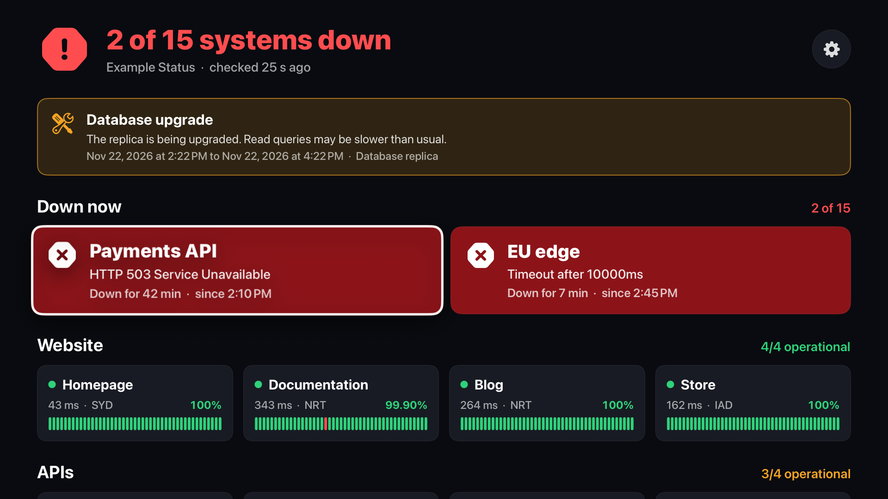
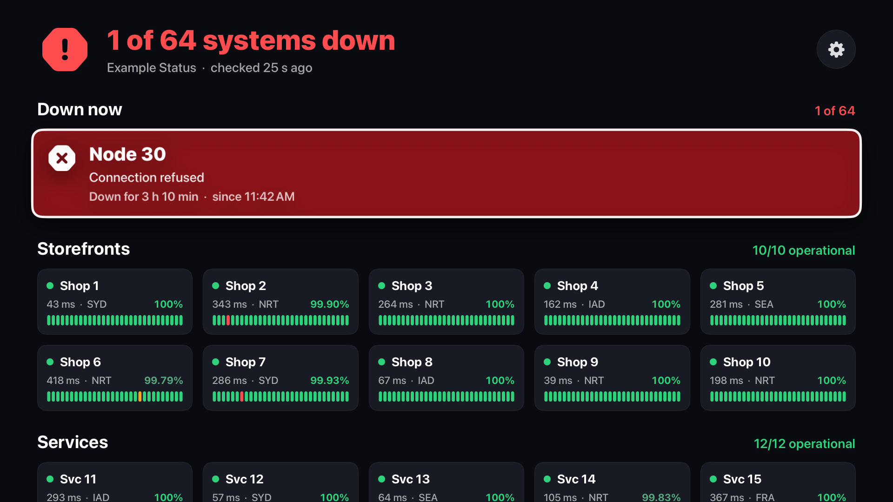
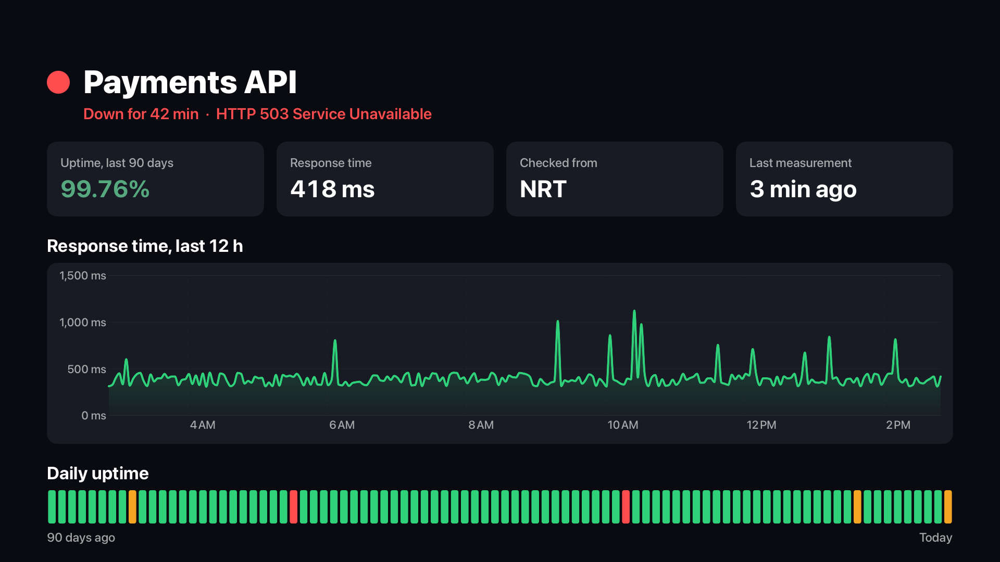

# Flare Status TV

An Apple TV app that shows an [UptimeFlare](https://github.com/lyc8503/UptimeFlare)
status page on a television: a wall display you can read from across the room,
that also works with the remote.

**Unofficial.** This project is not affiliated with or endorsed by UptimeFlare
or Cloudflare. It is original code that reads what an UptimeFlare status page
already publishes.



| | |
|---|---|
|  |  |

The screenshots use invented sample data (`-demo outage`, `-demo large`).

## What it shows

- **A banner** that answers the only question that matters: is everything up?
  It turns red and counts the failures when something is down, and amber when
  the data is stale or the status page cannot be reached.
- **Anything that is down, first**, in large red tiles with the failure reason
  and how long it has been down.
- **Every monitor, in the groups your status page uses**, with its state,
  response time, check location, uptime percentage and the daily history
  strip. The grid adapts from one monitor to more than sixty.
- **Maintenance notices**, active and upcoming.
- **A detail screen** for each monitor: response-time chart for the window
  UptimeFlare keeps (about 12 hours), 90 days of daily uptime, and its recent
  outages with their reasons.

It refreshes by itself (every minute by default), keeps the last good data on
screen when a refresh fails, and keeps the Apple TV awake while it is open.

When nobody has touched the remote for a minute and a half, it walks down the
page a couple of rows every eight seconds, reaches the last group, and starts
again from the top, so a page several screens tall is seen in full. It does
this by moving the focus, which is how tvOS scrolls. Pressing anything on the
remote stops it at once; it resumes from wherever you left the focus. Settings
has a switch for it (on by default). You can add more than one status page and switch between them, or
have the app rotate through them.

## Requirements

- Apple TV HD or Apple TV 4K running tvOS 17 or later.
- To build: a Mac with Xcode 16 or later. No third-party dependencies.
- An UptimeFlare deployment you can reach from the Apple TV.

## Supported UptimeFlare versions

Verified against upstream `lyc8503/UptimeFlare` at commit
[`8035521`](https://github.com/lyc8503/UptimeFlare/commit/8035521268a54222959eaf720c82f530e755b6bb)
(21 October 2026; upstream publishes no tagged releases) and against a live
deployment of that version.

| Deployment | Status |
| --- | --- |
| D1 storage (upstream since January 2026) | Supported, tested live |
| KV storage (upstream before January 2026) | Supported; decoder written from the upstream source at commit `51bf3be` and covered by unit tests, not tested against a live deployment |
| Password protected (`passwordProtection`) | Supported (HTTP Basic); covered by unit tests, not tested against a live protected deployment |
| Forks | Work as long as the page data keeps upstream's shape. Heartbeat ("push") monitors that record `push` as the location are shown as heartbeats |

### How the app reads a status page

UptimeFlare has one small JSON API, and it is not enough for a display: it has
no monitor names, no groups and no history. The app therefore reads the same
things a browser does. Everything is a plain `GET`.

| Request | Used for |
| --- | --- |
| `GET /` | The page's `__NEXT_DATA__` block carries `monitors` (id, name, tooltip, statusPageLink, hideLatencyChart) and the stored state as a JSON string: `compactedStateStr` on D1 deployments, `state` on KV deployments. This is where names, incidents and latency history come from. |
| `GET /api/data` | `{ up, down, updatedAt, monitors: { id: { up, latency, location, message } }, maintenances }`. A few kilobytes; used for the frequent refresh and for maintenance notices. |
| `GET /_next/static/chunks/*.js` | Once per build of the page: the page title and the monitor groups exist only in the page's compiled configuration, so the app looks for them there. If it cannot find them, monitors are shown ungrouped and the address is used as the title. |

The full page can approach a megabyte for a large deployment, so it is loaded
on launch, every ten minutes, and immediately when `/api/data` shows a monitor
changing state. In between only `/api/data` is polled.

## Build and install with Xcode

1. Clone the repository and copy the signing template:

   ```sh
   cp Config/Local.xcconfig.example Config/Local.xcconfig
   ```

   Put your Apple Developer team id and a bundle identifier you own in
   `Config/Local.xcconfig`. That file is git-ignored.

2. Open `FlareStatus.xcodeproj` in Xcode.

3. To try it in the simulator, pick an Apple TV simulator and press Run. No
   signing settings are needed for the simulator.

4. To install on your Apple TV: on the Apple TV open Settings > Remotes and
   Devices > Remote App and Devices; in Xcode open Window > Devices and
   Simulators and pair it. Then choose the Apple TV as the run destination and
   press Run. With a free Apple ID the app expires after seven days; with a
   paid developer account it lasts a year, or you can distribute it to
   yourself through TestFlight (below).

From the command line:

```sh
# unit tests (macOS, no simulator needed)
cd FlareStatusKit && swift test

# build and test for the tvOS Simulator
xcodebuild test -project FlareStatus.xcodeproj -scheme FlareStatus \
  -destination 'platform=tvOS Simulator,name=Apple TV 4K (3rd generation)'

# UI tests: drive the app with the remote (Settings, idle tour); a few minutes
xcodebuild test -project FlareStatus.xcodeproj -scheme FlareStatusUITests \
  -destination 'platform=tvOS Simulator,name=Apple TV 4K (3rd generation)' \
  -parallel-testing-enabled NO
```

The UI tests use the sample data. To run the idle-tour tests against a real
status page, and to keep the screenshots they take, pass
`TEST_RUNNER_STATUS_URL=https://status.example.com` and
`TEST_RUNNER_SCREENSHOT_DIR=/some/folder` in the environment of `xcodebuild`.
They are not part of CI, which runs the unit tests and a simulator build.

## Point it at your status page

On first launch the app asks for the address of the status page: the address
you open in a browser, for example `status.example.com`. When a text field is
selected, a nearby iPhone offers its keyboard, which is easier than the
on-screen one.

If the deployment sets `passwordProtection: 'user:password'`, enter the two
halves as user name and password. The password is stored in the Apple TV's
Keychain; everything else is stored in the app's preferences.

No status page yet? **Try with sample data** on the same screen shows invented
monitors, labelled as sample data, so you can look around first.

The app checks the address by loading it and tells you what went wrong if it
cannot: a malformed address, a server that cannot be reached, a page that is
not UptimeFlare, a wrong password, or a deployment that has no data yet.

Plain `http` is accepted only for addresses on your local network (an IP
address or a `.local` name), for self-hosted deployments.

Settings (the gear in the top right corner) lets you add or remove pages,
change the refresh interval, turn the idle scrolling off, and rotate between
pages.

### Demo mode

For trying the app without a deployment, pass a launch argument (in Xcode:
Product > Scheme > Edit Scheme > Run > Arguments):

- `-demo healthy`, `-demo outage`, `-demo single` or `-demo large`: invented data, no network.
- `-url https://status.example.com`: show this page without saving it.
- `-idleSeconds 5 -tourSeconds 2`: shorten the wait before the idle tour and the pause at each stop.

## TestFlight

`scripts/testflight.sh` archives the app, exports it and uploads it with an
App Store Connect API key. It contains no identifiers; it reads them from the
environment and from `Config/Local.xcconfig`.

Before the first upload you need a registered bundle identifier and an app
record (platform tvOS) in App Store Connect.

```sh
export ASC_KEY_ID=...        # App Store Connect API key id
export ASC_ISSUER_ID=...     # issuer id
export ASC_KEY_PATH=/path/to/AuthKey_XXXX.p8
BUILD_NUMBER=2 scripts/testflight.sh              # archive, export, upload
scripts/testflight.sh --no-upload                 # stop after exporting the IPA
scripts/testflight.sh --check                     # validate the setup only
```

The marketing version lives in `Config/Base.xcconfig`. Each upload needs a
higher `BUILD_NUMBER` than the last; without one the script uses a UTC
timestamp.

## Privacy

The app collects no data. It talks only to the status pages you add: it has no
analytics, no accounts, no advertising and no third-party code, and it sends
nothing except `GET` requests to those pages (with the password you entered,
if any). The full policy is in [PRIVACY.md](PRIVACY.md).

## Support

See [SUPPORT.md](SUPPORT.md), or open an
[issue](https://github.com/WoofyIO/flare-status-tv/issues).

## Project layout

| Path | What it is |
| --- | --- |
| `FlareStatusKit/` | Swift package: decoding of both UptimeFlare storage formats, the model, the HTTP client, sample data. No UI. Unit tested. |
| `FlareStatus/` | The SwiftUI tvOS app. |
| `FlareStatusUITests/` | UI tests that drive the app with the remote. |
| `Config/` | Build settings. `Local.xcconfig` (yours, untracked) overrides `Base.xcconfig`. |
| `scripts/make-fixtures.mjs` | Regenerates the invented test fixtures. |
| `scripts/make-artwork.swift` | Draws the app icon and Top Shelf images. |
| `scripts/testflight.sh` | Archive and upload. |

## License and credit

Apache License 2.0; see [LICENSE](LICENSE) and [NOTICE](NOTICE).

This is original code and includes none of UptimeFlare's. Thanks to
[lyc8503](https://github.com/lyc8503) and the UptimeFlare contributors for
[UptimeFlare](https://github.com/lyc8503/UptimeFlare), which is also Apache 2.0
licensed. The artwork is original and uses neither UptimeFlare's nor
Cloudflare's logos.
